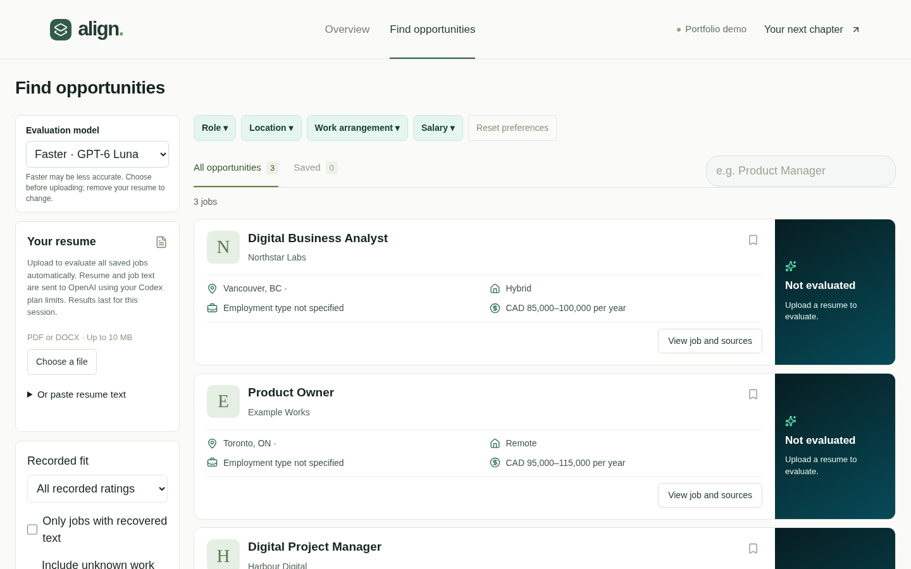

# Align

Align is an early-stage job discovery and resume evaluation prototype built with Next.js, TypeScript and Tailwind CSS. It imports a job tracker, lets a user filter and save opportunities, and experiments with evidence-based evaluations using four categories: **Fit**, **Consider**, **Investigate** and **Weak Fit**.

This is a portfolio work in progress, designed to run as a private, single-user Codespace. It is not a hosted public product. The automatic evaluation flow is experimental: model outputs can fail source verification or return Investigate, and results need human review. Job listings are imported by the user; the application does not run a live job search.



*The dashboard shown above uses fictional job listings. It illustrates the interface; the jobs shown have not been evaluated.*

## What works today

- Import and merge tracker spreadsheets or supported JSON backups; browse, filter and bookmark saved jobs.
- Extract text from PDF and DOCX resumes and start a Codex-based evaluation of imported jobs.
- Inspect captured job descriptions, sources and evaluation explanations. Results are temporary and are not verified hiring advice.
- Use the included fictional sample jobs and resumes to explore and test the interface.

## Imported-job workflow

1. Open **Import or back up jobs** in the sidebar and import a tracker spreadsheet or recovered Align JSON file. Jobs and bookmarks persist in the private Codespace database.
2. Select a PDF/DOCX resume. Align automatically extracts it and evaluates all stored imported jobs using the server's installed, ChatGPT-signed-in Codex CLI. Pasted text starts with **Use pasted resume**.
3. Follow queue progress below the resume upload and open job details for reasons and source evidence. Labels are **Fit**, **Consider**, **Investigate**, and **Weak Fit**. Per-job checklists are removed. Missing, short or truncated descriptions remain Investigate without model inference.

**Data sharing:** extracted resume and job text are sent to OpenAI, using your Codex plan limits. No API billing is configured. The app does not store resumes or evaluation results; results clear on refresh. Imported jobs/bookmarks are stored in ignored `.align-data/`. Do not add personal imports, resumes, credentials or database files to Git. No personal data is included in the fictional test fixtures.

Codex must be installed and signed in with ChatGPT (`codex login status`). The faster option uses `gpt-6-luna`, subject to account and CLI availability; it may be less accurate than the standard Codex default. Choose a model before selecting a resume. If the faster model is unavailable, remove the resume, choose standard, and select it again. The app evaluates one job at a time, and actual speed depends on the model and service. No API-key fallback is provided. Connection and service failures stop with a retry option. Unverifiable model output is marked Investigate and the queue pauses with a diagnostic category; no fit is guessed. Retry skips completed jobs while the same page, resume and job list remain open; results still clear on refresh. Read the [evaluation design and limitations](docs/evaluation-design.md) for the rubric, isolation, privacy and retention boundaries.

## Local development

Requirements: Node.js 22.13 or later and npm. The evaluation feature also requires a separately installed Codex CLI signed in with a supported ChatGPT account; availability and usage limits depend on the account.

```sh
npm ci
npm run dev
```

Keep the Codespace forwarded port **private**. This app is intended for a single user behind that private preview; it has no public account or tenant isolation layer. Do not deploy publicly without additional access controls. No public deployment has been configured.

```sh
npm run typecheck
npm run lint
npm test
npm run build
npm run test:e2e
```

The browser suite uses an isolated temporary SQLite database and fictional resumes/jobs. To test actual Codex connectivity with fictional data only:

```sh
ALIGN_CODEX_SMOKE=1 npx vitest run src/lib/matching/codex.test.ts
```

PDF and DOCX extraction accepts files up to 10 MB. Scanned PDFs require OCR, which is not implemented. Sample opportunities remain a separate manual demonstration of the existing evidence rubric. Sample resume files under `public/sample-resumes` contain fictional data.
